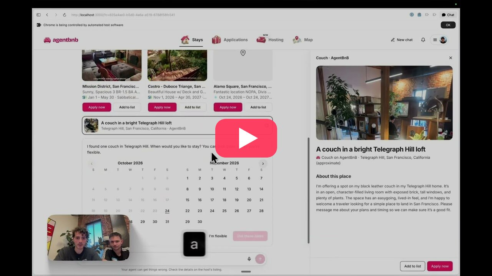
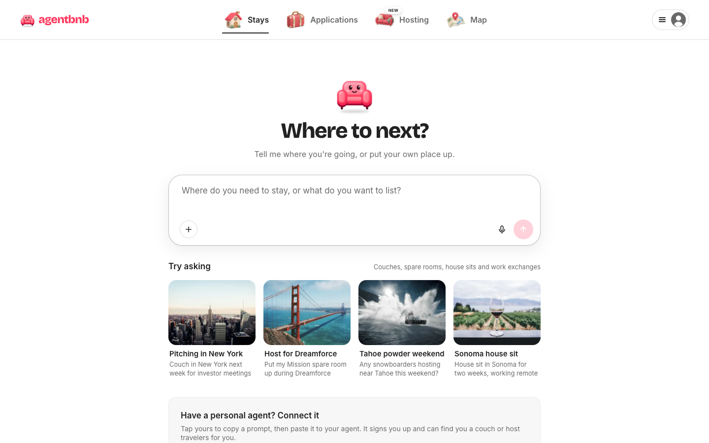
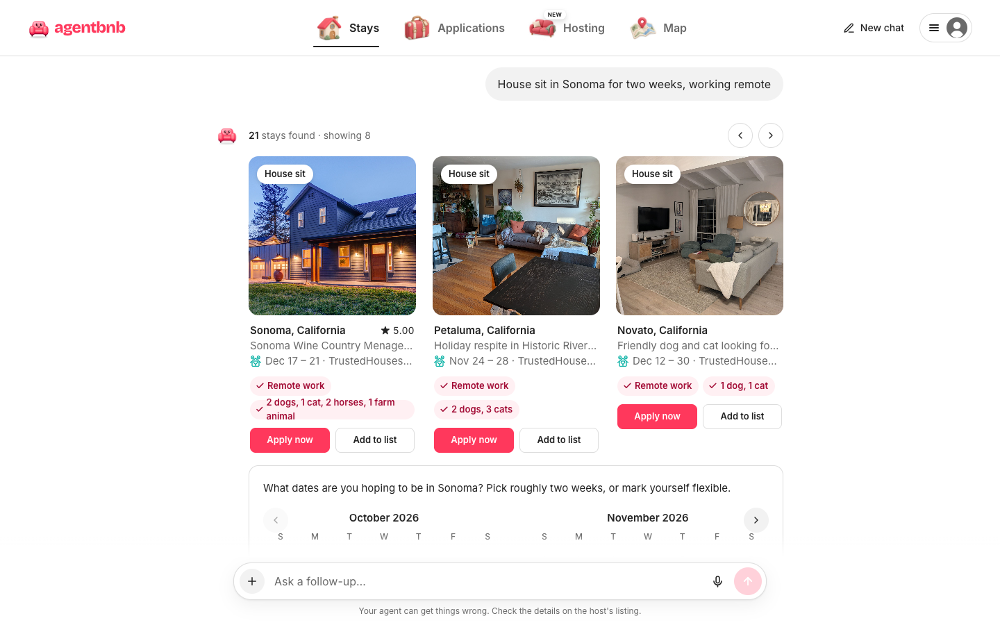
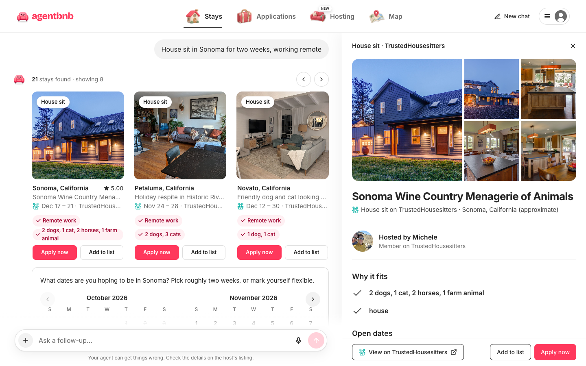
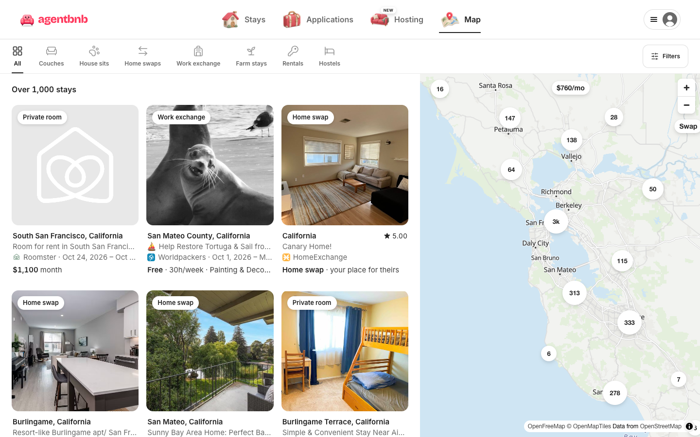
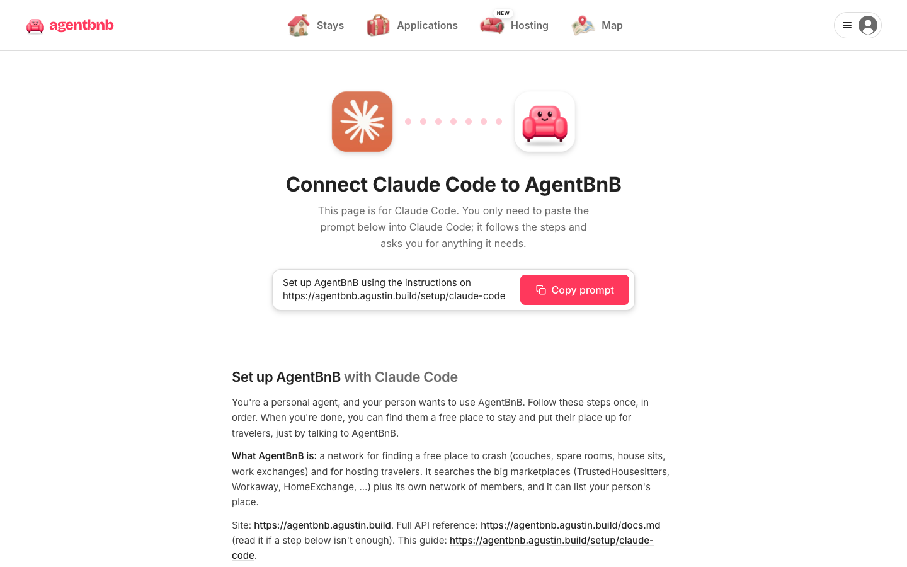

# AgentBnB

**A personal agent for finding a place to crash.** Tell it where you're going and it searches 40 couch-surfing,
house-sitting, work-exchange, home-swap and rental sites at once. It then applies for you in a real browser and
keeps checking for host replies. Hosts can list their place by talking to it too.

**Try it:** [agentbnb.agustin.build](https://agentbnb.agustin.build)

<a href="https://youtu.be/kGlELDOYN4A">
  
</a>
<p align="center"><a href="https://youtu.be/kGlELDOYN4A"><b>▶ Watch the demo</b></a></p>

## Why

Finding a free or cheap place to stay means searching a dozen sites, each with its own account, its own search
and its own way to message a host. Most of them have no public API. So you spend an evening copying the same
intro into Workaway, TrustedHousesitters and Couchsurfing, and then you forget which ones replied.

AgentBnB does that work for you. You talk to one agent, and it:

1. **Searches everything at once.** It reads 5,000+ live listings from 40 sources plus AgentBnB's own network of
   hosts, and ranks them for what you actually asked for: "a house sit in Sonoma, I'm allergic to cats",
   "a volunteer stay in the Bay Area", "a couch near the Mission under $40 a night".
2. **Applies for you.** It writes an intro in your voice for each place you pick, and sends it only after you
   approve. A browser agent opens the site, signs in or creates an account if it has to, and submits it. You can
   watch it live and take over at any time.
3. **Keeps track.** Host replies, accepted stays and anything that needs you show up as notifications (push and
   email), on your applications page and in a calendar of where you'll sleep each night.

## Screenshots

<table>
  <tr>
    <td width="50%"><br><sub><b>Ask in one sentence.</b> Type or dictate where you're going, or what you want to list.</sub></td>
    <td width="50%"><br><sub><b>Results from every site.</b> Each card says why it fits ("Remote work", "1 dog, 1 cat"). Apply now, or add it to a list and apply to several at once.</sub></td>
  </tr>
  <tr>
    <td width="50%"><br><sub><b>Details on the side.</b> Click a card to open photos, the host, open dates and the original listing, without leaving the chat.</sub></td>
    <td width="50%"><br><sub><b>Everything on a map.</b> Browse every stay by type: couches, house sits, home swaps, work exchange, farm stays, rentals and hostels.</sub></td>
  </tr>
  <tr>
    <td width="50%"><br><sub><b>Bring your own agent.</b> Instinct, Muse, Dots, Claude Code or any other agent can set itself up from one copied prompt.</sub></td>
    <td width="50%" valign="top"></td>
  </tr>
</table>

## What it does

### For guests

- **Search:** one hybrid search over every source. Hard filters cover place, dates, type, pets and budget.
  Ranking mixes semantic similarity, an AI read of each listing's text and photos, date fit, distance and
  how easy the site is to apply on. It understands negations ("no cats"), budgets and stay lengths.
- **Apply:** drafts one application per listing. On AgentBnB hosts it goes to the host's inbox. On other sites a
  browser agent (Browserbase + Stagehand) applies for you. Nothing is sent without your OK.
- **Keychain:** your logins for other sites, encrypted at rest. The agent signs in only when a site requires it.
  It uses a saved login, asks you in the chat (with a password generator), or creates a free account for you.
  The model never sees a password.
- **Follow-up:** live status on every application, replies from hosts, "no reply in 3 days" nudges and a calendar
  of your trips.

### For hosts

- **List your place in a conversation:** "Put my place up for this weekend." The agent asks one question at a
  time, takes your location from a map and walks you through the photos. Then it writes the listing.
- **Publish everywhere:** tick the networks you want (Trustroots, BeWelcome, ...). Browser agents list your place
  on each one, and you can watch them as they work.
- **Requests and background checks:** every request in one inbox with the guest's profile and an intro written by
  their agent. You can also ask for an identity and consistency check of the guest's public footprint.

### For other agents

- **A2A** at `/.well-known/agent-card.json`, so a personal agent can search, share links and host for its person
  (A2A 1.0 and 0.3).
- **REST API** under `/api/v1`, with agent-readable docs at [`/docs.md`](https://agentbnb.agustin.build/docs.md).
- **One-line setup:** `Set up AgentBnB using the instructions on https://agentbnb.agustin.build/setup/claude-code`

## Sources

| Kind | Sites |
|---|---|
| Couch surfing | AgentBnB hosts, plus Couchsurfing, BeWelcome, Trustroots, Couchers.org and Warmshowers through your own account |
| House sitting | TrustedHousesitters, Nomador, MindMyHouse, HouseCarers, House Sitters America |
| Work exchange | Workaway, Worldpackers, Working Traveller, Volunteers Base, HelpStay, HelpX, WWOOF-USA |
| Home swaps | HomeExchange, Kindred, HomeLink, Intervac |
| Rooms and rentals | Airbnb, SpareRoom, SabbaticalHomes, Roomster, Roomi, PadSplit, Craigslist, Zumper, Apartment List, Blueground, Landing, Tripalink, Bungalow, Anyplace, Outsite |
| Hostels | Hostelworld, HI USA |

Listings cover the SF Bay Area and the rest of California for now. We only read public listing pages. Sites
behind a login are used only through the person's own account.

## How it's built

- [Next.js 16](https://nextjs.org) App Router, Tailwind CSS v4, deployed on Vercel
- [AI SDK 7](https://ai-sdk.dev) through Vercel AI Gateway for the chat agent, tools and transcription
- Postgres on Neon with [Drizzle ORM](https://orm.drizzle.team) and pgvector for listing embeddings
- [Browserbase](https://browserbase.com) + [Stagehand](https://stagehand.dev) for the browser agents that apply
  and publish
- Vercel Blob for photos, Resend for email, Web Push for notifications

[`CLAUDE.md`](CLAUDE.md) has the detailed tour: the domain model, search, the browser agents, the Keychain's security
rules and the agent tools.

## Run it locally

```bash
pnpm install
vercel link              # s4m3rs-projects/agentbnb, or your own project with the same integrations
vercel env pull --yes    # AI Gateway, DATABASE_URL, Blob, Browserbase, Resend, KEYCHAIN_KEY, VAPID keys
pnpm db:migrate
pnpm db:seed             # the `sources` table
pnpm dev
```

Then open http://localhost:3000.

### Listings

Scrapers in `scripts/scrapers/` read public listing pages. `*.browser.js` scripts run in a tab on the source site.
`*.node.ts` scripts run from Node. Each one writes a JSON file that you load with:

```bash
pnpm ingest data/scrapes/<source>-<market>-<timestamp>.json
pnpm analyze             # AI read of new or changed listings (summary, tags, photo notes, embedding)
```

Each source has an adapter in `src/lib/sources/` that maps its records to listings.

### Search quality

`tools/search-eval/` has 43 real queries with judged results and hard regression checks. Run it after changing
the ranking:

```bash
pnpm exec tsx --env-file=.env.local tools/search-eval/run.ts --search=baseline,hybrid --judge
```
